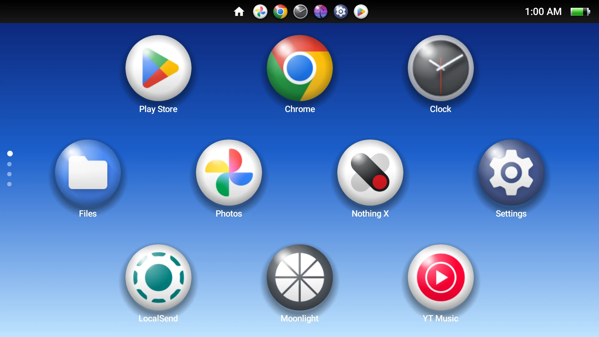

# Nouveau-Vita
A PS Vita style launcher for Android devices/handhelds featuring music and sound effects from the Vita.

### Features
- bubble grid interface
- folders
- edit mode for icon rearrangement
- PS Vita system sounds and looped music
- custom background music
- sfx & music audio mix adjustment
- color theme backgrounds
- support for custom photo and Android live wallpapers
- recent apps switcher in status bar like LiveArea
